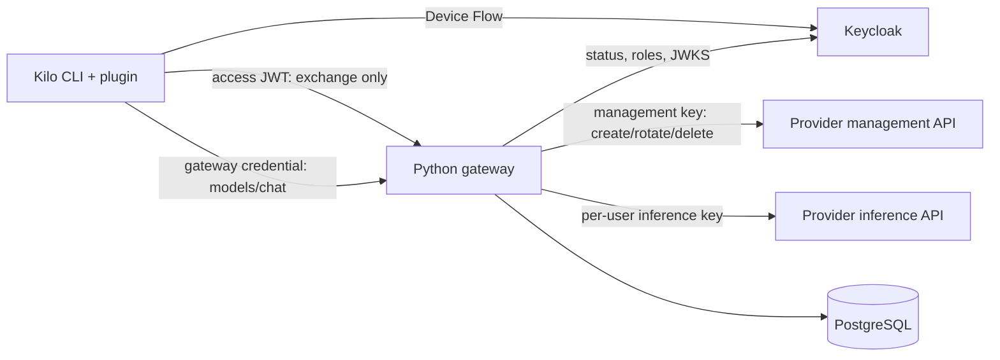

# Границы компонентов

`gateway/` — самостоятельный Python project и Docker build context. `plugin/` — самостоятельный npm package с auth runtime и JSONC installer; Python на клиенте не требуется. `tools/` связывает компоненты только для dev/bootstrap, config export, testing и release assembly. `deploy/` содержит инфраструктурные примеры, `config/` — public environment profiles. Root Makefile/Compose — orchestration workspace.

Gateway credential, Keycloak access token, provider management credential и пользовательский inference key — четыре разных секрета. Только gateway credential сохраняется в native Kilo auth store. Access JWT используется при exchange; management/inference secrets остаются на сервере. Публичный client config не содержит ни одного ключа.

Каталог из двух моделей задаётся сервером. Policy хранит разрешённые ID и provider grants. `/v1/models` и `/me` отражают разрешения, prepare/reservation проверяют их до upstream call. Выбор в Kilo передаёт публичный ID; server mapping определяет реальный upstream model. В FAKE профиле оба ID всегда ведут в локальный fixture.

Основной `OpenAICompatibleAdapter` отделён от credential lifecycle фабрикой `providers/factory.py`. В `static`/`none` credential manager отсутствует: SSO выдаёт персональный gateway credential, inference использует серверный service key или явно заданный no-auth режим. Никаких `/keys` вызовов/фиктивных per-user allocations нет. В текущем default `openrouter-managed` manager отвечает за lifecycle/AES storage, а тот же generic adapter — за inference. Managed credential namespace/AAD и накопленные allocations при миграции остаются прежними.

Все адреса внешних сервисов выбираются endpoints-профилем, а credentials — secret files/secret mechanism. Management, catalog и inference могут находиться на разных HTTPS hosts и paths. OIDC может использовать отдельные endpoint hosts только через явный allowlist; issuer/signature/audience checks сохраняются. Gateway public prefix поддерживается через reverse proxy.

Поставки: `artifacts/releases/y-ai-gateway-0.1.0.tar.gz` — server only; `company-kilo-auth-0.1.0.tgz` — client only; `y-ai-workspace-0.1.0.tar.gz` — все исходники и integration tools. Manifest/SHA256SUMS и secret scan проверяются при упаковке. В releases не входят `.env`, `.local`, реальные credentials или dependency trees.
